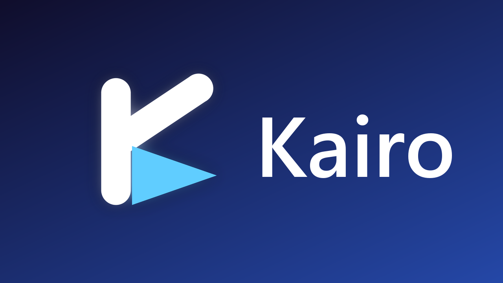
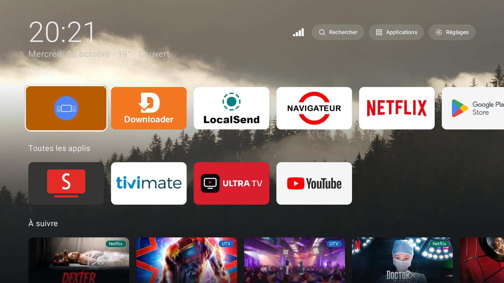
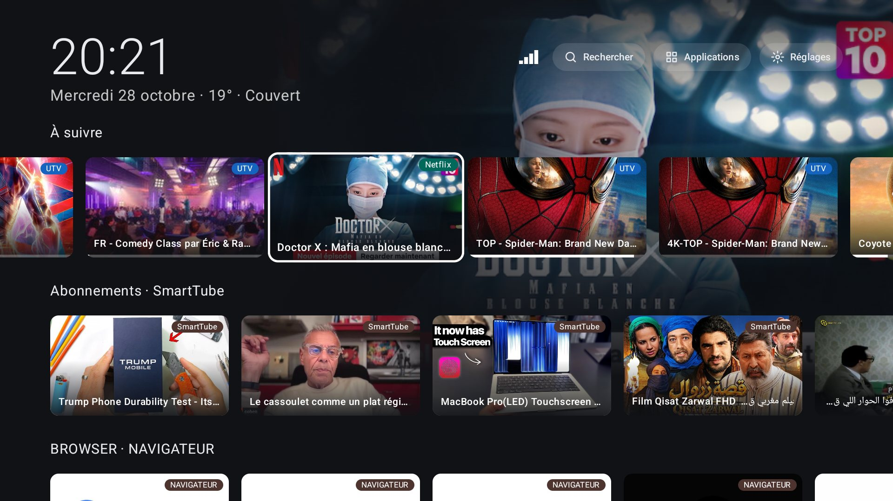
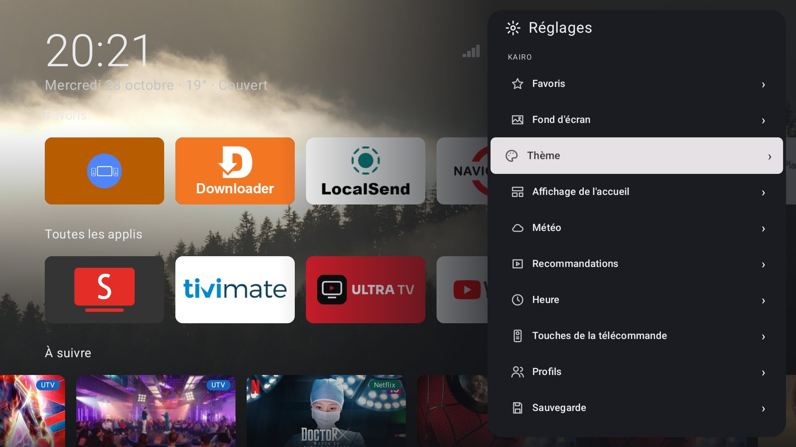
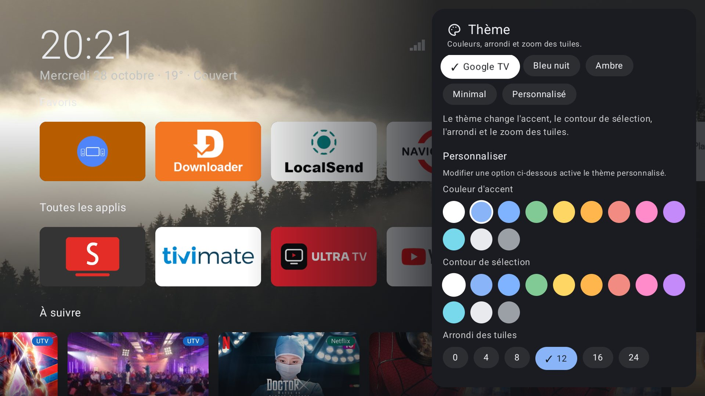
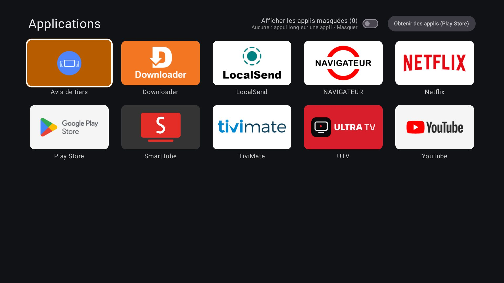
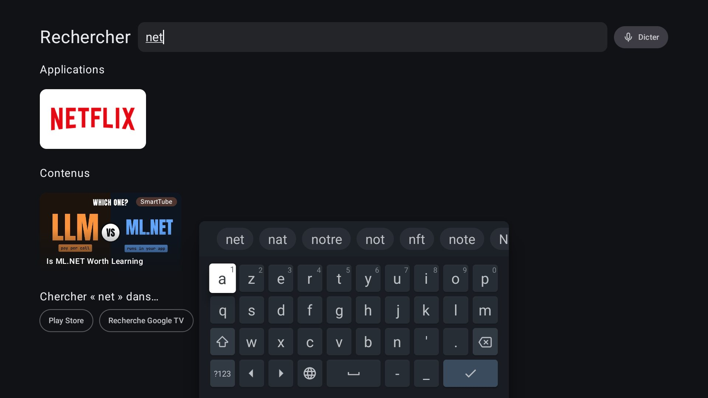
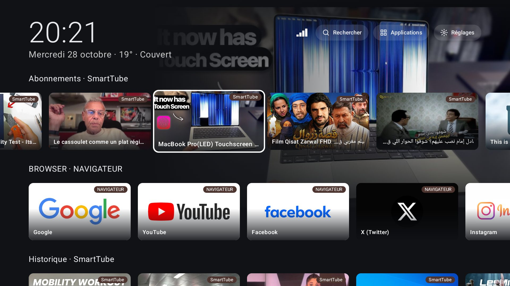
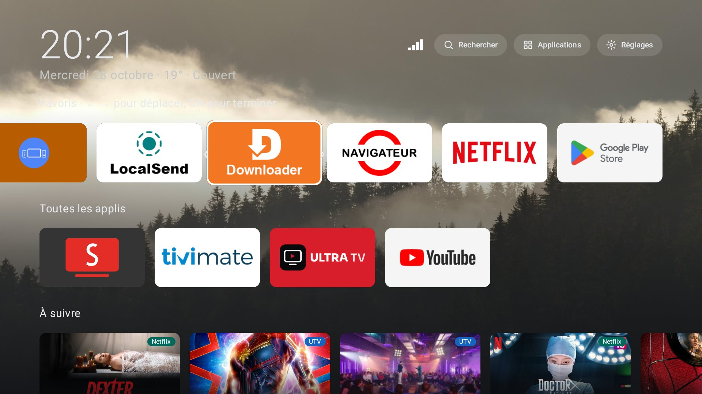
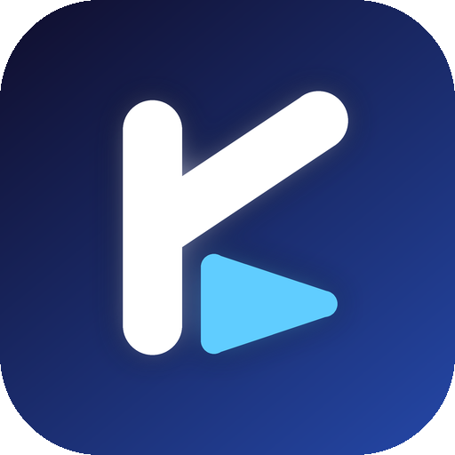

<p align="center">
  
</p>

<p align="center">
  <b>Le launcher Android TV complet… qui reste fluide sur les petites box.</b><br>
  Accueil épuré façon Google TV, recommandations de vos applis, personnalisation poussée — sans compte Google, sans pub, sans traqueur.
</p>

<p align="center">
  <a href="https://github.com/vantaflow/kairo/releases/latest"></a>
  
  
  
  <a href="https://vantaflow.github.io/kairo/"></a>
</p>

---



## Pourquoi Kairo ?

Les box Android TV d'entrée de gamme (2 Go de RAM, processeur 32 bits) rament sous Google TV, et les launchers alternatifs rapides sont souvent austères. Kairo vise les deux : **tout ce qu'on attend d'un écran d'accueil moderne**, mesuré et optimisé image par image sur une **Mecool KM7 Plus** (Android 14, 2 Go).

| Mesuré sur la KM7 Plus | Kairo |
| --- | --- |
| Temps médian par image en naviguant dans les recommandations | **34 ms** (85–97 ms avant optimisation) |
| Taille de l'appli | **~3 Mo** |
| Compte Google, pubs, collecte de données | **aucun** |

## Fonctions

**Accueil**
- Favoris en tête, rangée « Toutes les applis », puis **À suivre** et les rangées de recommandations publiées par vos applis (Netflix, YouTube, SmartTube, TiviMate…).
- **Fond « héros »** : l'affiche du contenu sélectionné, floutée et fondue en dégradé, comme sur Google TV.
- Heure synchronisée sur un serveur de temps (NTP), date et **météo** (Open-Meteo, position par IP ou ville).
- Rangée sélectionnée calée sous l'en-tête : rien n'est jamais coupé en défilant.



**Personnalisation**
- Fonds : images **Pixabay** par thème (nature, ville, mer, espace…), dégradés ou couleurs unies.
- Thèmes prêts à l'emploi ou thème sur mesure : couleurs, contour et zoom au focus, arrondi des tuiles, taille des tuiles, titres de rangées.
- Ordre et visibilité des recommandations **par appli et par rangée**.

**Télécommande**
- Navigation complète au D-pad, appui long ou touche Menu pour les actions d'une appli.
- **Touches YouTube / Netflix / Prime Video / Disney+ réassignables** vers n'importe quelle appli.

**Réglages en panneau latéral**
- Panneau à droite par-dessus l'accueil : les changements se voient en direct.
- Réseau (Wi-Fi / Ethernet), raccourci HDMI-CEC et accès direct aux paramètres Android de la box.
- Profils (dont un **profil enfant** verrouillé par code), sauvegarde et restauration, nettoyage mémoire, mise à jour depuis GitHub.

| Menu des réglages | Section Thème |
| --- | --- |
|  |  |

**Et aussi**
- **Favoris à déplacer directement sur l'accueil**, comme sur Google TV : appui long › Déplacer, puis ← →.
- Toutes les applis, applis masquées, accès au Play Store.
- Recherche dans les applis et les contenus, avec dictée vocale.
- Écran de veille Kairo (images, heure, météo).

| Toutes les applications | Recherche |
| --- | --- |
|  |  |
| **Rangées de recommandations** | **Déplacer un favori** |
|  |  |

<sub>Captures prises sur une Mecool KM7 Plus.</sub>

## Comment rester fluide sur une petite box

Kairo est écrit en Kotlin avec Jetpack Compose et chaque écran a été profilé sur la box (traces système `atrace`) :

- **Build release** R8 + profil de démarrage, compilé à l'avance (`cmd package compile -m speed`).
- **Fonds figés dans une texture** : le fond d'écran et le fond « héros » ne sont redessinés que lorsqu'ils changent, jamais pendant la navigation.
- **Tuiles et cartes légères** : zoom et contour lus uniquement au dessin, aucune recomposition au changement de focus ; une seule affiche décodée par contenu, en RGB 565.
- **Accessibilité Compose coupée** : les box gardent toujours des services d'accessibilité actifs (télécommande, constructeur), ce qui faisait reparcourir tout l'écran à Compose à chaque défilement — environ 100 ms perdues par seconde.

## Installation

1. Téléchargez `kairo-x.y.z.apk` depuis la [dernière version](https://github.com/vantaflow/kairo/releases/latest).
2. Installez-le (Downloader, clé USB ou `adb install kairo-x.y.z.apk`).
3. Ouvrez Kairo puis **Réglages › Écran d'accueil par défaut**.

Pour un réglage complet en une commande depuis un PC (autorisations, touches de la télécommande, écran de veille) :

```bash
scripts/deploy.sh <IP_DE_LA_BOX> --no-build   # avec l'APK placé dans build-remote/app-release.apk
```

<details>
<summary>Autorisations accordées par ADB (facultatif)</summary>

```bash
adb shell pm grant com.tvhome.launcher com.android.providers.tv.permission.READ_EPG_DATA
adb shell pm grant com.tvhome.launcher android.permission.READ_TV_LISTINGS
adb shell cmd role add-role-holder android.app.role.HOME com.tvhome.launcher
```

`READ_TV_LISTINGS` est indispensable pour lire « À suivre » et les recommandations des autres applis.
</details>

## Compiler

Prérequis : JDK 17, Gradle 8.7, SDK Android 34.

```bash
echo "PIXABAY_API_KEY=votre_clé" > secrets.properties   # facultatif : clé Pixabay intégrée
gradle :app:assembleRelease
```

Sans clé, les fonds Pixabay restent disponibles en saisissant sa propre clé dans **Réglages › Fond d'écran**.
Le dépôt contient aussi `scripts/remote.py` pour compiler sur un serveur distant (configuration dans `remote.properties`).

## Vie privée

Kairo n'a ni compte, ni publicité, ni statistiques. Les seuls appels réseau : la météo (Open-Meteo, position approximative par IP via geojs / ipwho.is), les images Pixabay si vous les choisissez, l'heure NTP et la vérification des mises à jour sur GitHub.

## Du même auteur

📺 **[Ultra TV](https://github.com/vantaflow/ultra-tv)** — lecteur IPTV pour Android TV / Google TV, smartphone, tablette, Windows et Mac : Xtream Codes et M3U, guide TV, replay, pause du direct, profils. Ses recommandations s'affichent directement dans Kairo. → [Site d'Ultra TV](https://vantaflow.github.io/ultra-tv/)

---

<p align="center"><br><sub>Kairo — fait pour les box modestes et les gens exigeants.</sub></p>
